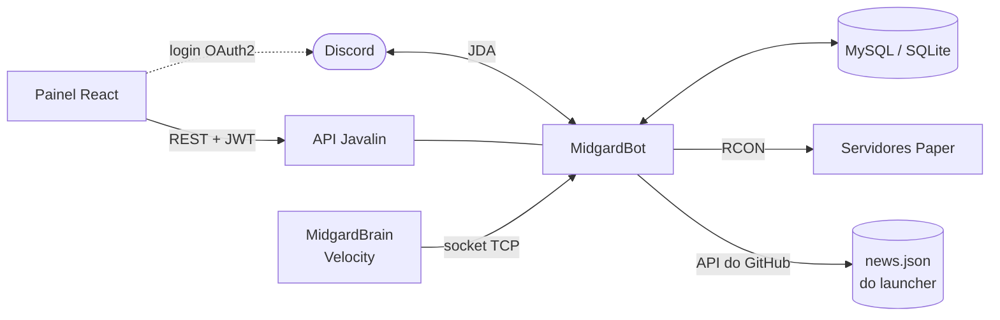

# MidgardBot

[](https://github.com/EduardoPSoares/MidgardBot/actions/workflows/build.yml)


Bot de Discord e painel web para administrar a comunidade de um servidor Minecraft de roleplay.

## Destaques

- **Bot (JDA)**: tickets com categorias e horário de atendimento, whitelist por formulário, punições com
  acompanhamento, vínculo de conta Discord e Minecraft, sincronização de cargos, boas-vindas, logs, backups e
  monitor de status do servidor.
- **Reuniões**: gravação de áudio dos canais de voz (Opus) e geração de ata em PDF.
- **Painel web**: API REST em Javalin com login via Discord OAuth2 e JWT, e front-end em React 19 + Tailwind.
- **Integração com o jogo**: recebe eventos do proxy por socket TCP autenticado e executa comandos nos servidores
  por RCON (cliente RCON próprio).
- **Notícias**: publica as notícias do Discord no repositório do launcher via API do GitHub.
- **Persistência**: MySQL (HikariCP) ou SQLite.

## Arquitetura



## Stack

Java 21 · Maven · JDA · Javalin · JWT · MySQL/SQLite · React 19 · Vite · Tailwind CSS

## Como rodar

1. Copie `config.env.example` para `config.env` e preencha token, IDs e banco.
2. Compile e rode o bot:
   ```bash
   mvn package
   java -jar target/MidgardBot-*.jar
   ```
3. Painel web (desenvolvimento):
   ```bash
   cd web && npm install && npm run dev
   ```
